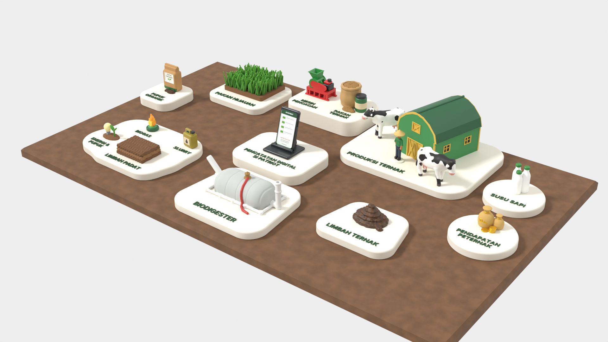
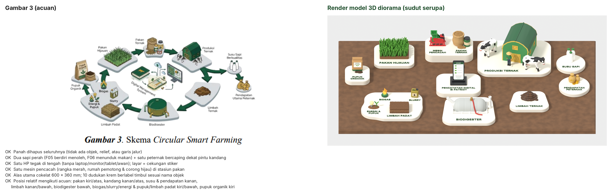
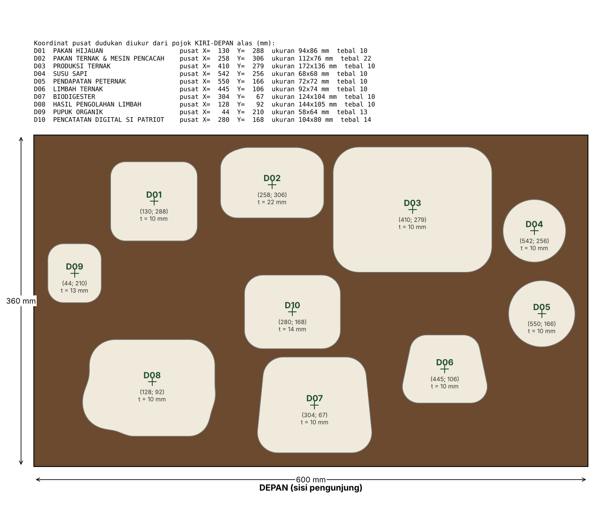
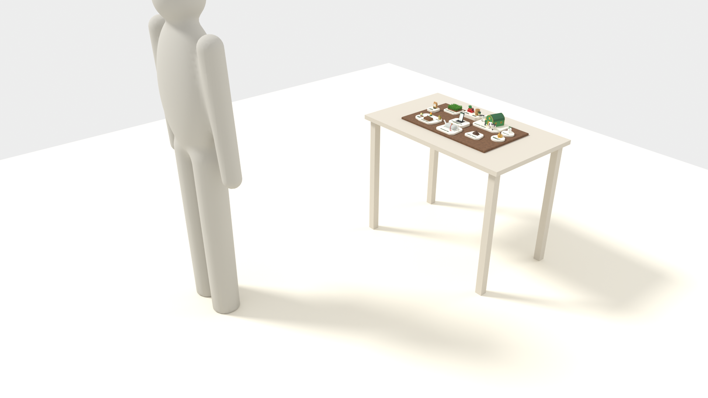

# Diorama 3D *Circular Smart Farming* — SI PATRIOT

Model diorama cetak-3D (FDM, nozzle 0,4 mm) yang mengekstrak **Gambar 3. Skema Circular Smart Farming** menjadi objek fisik:
alas cokelat **600 × 360 mm**, 10 dudukan krem berlabel, 18 figur/alat, tanpa panah dan tanpa jalur penghubung.



| Gambar acuan vs model (sudut serupa) |
|---|
|  |

---

## 1. Status yang jujur

| Sudah dibuat & diperiksa | Belum / di luar kemampuan saya |
|---|---|
**Satu set cetak utama = 28 STL** (`stl/dudukan/` 10 + `stl/figur/` 18, tanpa dobel); varian alternatif dipisah di `stl/opsional/`. Total 49 STL — **49/49 lolos** pemeriksaan otomatis: tertutup, volume > 0, **satu badan**, alas di **Z = 0**, valid di manifold3d, muat bed 220 × 220 | Belum ada cetak fisik. Semua verifikasi bersifat geometri + **uji iris PrusaSlicer 2.7** (bukan percobaan di printer Anda). Cetak uji dulu (lihat §5). |
| Uji iris setiap STL: **hanya 2 sapi yang perlu support**; semua lainnya ≤ 1 % (praktis tanpa support) | Warna di render = **panduan cat/ganti filamen**. Printer FDM satu warna akan mencetak satu warna; diperlukan cat akrilik atau ganti filamen di ketinggian tertentu (tabel §5.3). |
| Uji garis pandang (ray casting) dari mata pengunjung 1 m di depan meja → semua 14 label ≥ 92 % terlihat untuk tinggi mata 155 cm **dan** 145 cm | Stiker layar HP berisi **placeholder** “CONTOH TATA LETAK”. Tangkapan layar App/Website SI PATRIOT yang asli harus Anda sediakan (ukuran 23,1 × 43,1 mm). |
| Berkas `.blend` lengkap + kode parametrik (Python) untuk membangun ulang semuanya | Meja: kedalaman 60 cm masih **perkiraan** — ukur ulang (lihat §8). |

Biodigester (revisi) = **tipe kantong/balon fleksibel** sesuai foto acuan tim: kantong terpal berjahit di atas rangka pipa, pipa inlet miring, pipa outlet tegak, katup gas kuningan + selang merah. Tetap miniatur ilustratif, bukan replika ukuran unit lapangan. Kantong uang adalah simbol hubungan dalam skema, **bukan klaim** angka pendapatan.

---

## 2. Isi serah-terima (8 butir yang diminta)

| # | Permintaan | Berkas |
|---|---|---|
| 1 | Satu adegan 3D lengkap di alas cokelat | `blend/diorama_si_patriot.blend` (koleksi ALAS_UTAMA, DUDUKAN, FIGUR, STIKER_RENDER, MEJA_PAMERAN; kamera tersimpan `CAM_*`) |
| 2 | Proyek yang bisa diedit | `.blend` di atas + **sumber parametrik** `src/*.py` (ubah ukuran/posisi lalu bangun ulang) |
| 3 | STL terpisah tiap figur, alat, dudukan | **Set cetak utama:** `stl/dudukan/` (D01–D10) + `stl/figur/` (F01–F18) = 28 berkas, masing-masing dicetak 1×. Alternatif (jangan dihitung bersama set utama): `stl/opsional/dudukan_varian_stiker/` (pengganti D01–D10 bila tidak bisa ganti filamen), `stl/opsional/sapi_varian_belah/` (pengganti F05/F06), `stl/opsional/alas_cetak3d/` (pengganti papan MDF) |
| 4 | Daftar objek & jumlah cetak | [`docs/daftar_objek_dan_rencana_cetak.md`](docs/daftar_objek_dan_rencana_cetak.md) |
| 5 | Render atas, depan, tiga perempat | `render/diorama_top.png` (atas), `render/diorama_front_elevasi.png` (elevasi depan ortografik), `render/diorama_front_pengunjung_1m.png` + `..._zoom.png` (dari mata pengunjung), `render/diorama_three_quarter.png`, `render/diorama_iso_acuan.png` (sudut gambar acuan); pratinjau depan + ¾ per objek beserta ukuran & posisi: `render/objek/*.png`, `render/katalog_semua_objek.png` |
| 6 | Perbandingan dengan meja 96 × 60 | `render/diorama_meja_tiga_perempat.png`, `render/diorama_meja_atas_ukuran.png`, `render/diorama_meja_pandangan_pengunjung.png`, `docs/simulasi_meja_96x60.png` |
| 7 | Panduan pemasangan & urutan cetak | §5 dan §6 di bawah; template 1:1: `docs/template_penempatan_1-1_penuh_600x360.pdf`, `docs/template_penempatan_1-1_A4.pdf`, `docs/template_figur_per_dudukan_1-1_A4.pdf`; denah `docs/denah_tata_letak_mm.png` |
| 8 | Pemeriksaan STL | [`reports/stl_check.md`](reports/stl_check.md), `reports/stl_check.csv/json`, `reports/slicing.csv/json`, `reports/visibility_mata1550.json`, `reports/visibility_mata1450.json` |

Stiker: `docs/stiker_label_A4_skala_1-1.pdf` (label dudukan untuk varian stiker + stiker layar HP + label karung pupuk).

---

## 3. Tujuh penyesuaian wajib — status

| # | Penyesuaian | Bagaimana dipenuhi |
|---|---|---|
| 1 | Hapus semua panah | Tidak ada panah sebagai objek, relief, garis, atau dekorasi; juga tidak ada jalur melingkar. |
| 2 | Dua sapi perah | F05 (berdiri, kepala menoleh ke penonton) dan F06 (kepala menunduk makan, kaki melangkah). Gaya sama, pose beda; kepala, telinga, badan, 4 kaki, ekor, ambing + 4 puting, corak (cat). |
| 3 | Satu peternak menyatu dengan kandang | F07 + caping F08, berdiri di depan pintu kandang pada dudukan D03 (bukan stasiun sendiri). |
| 4 | Satu HP di tengah | F18 pada D10 (tengah). Tidak ada laptop, monitor, tablet, awan, atau HP kedua. |
| 5 | Satu mesin pencacah di area pakan | F03 pada D02: rangka merah, rumah pemotong (drum), corong pemasukan, saluran keluar, motor. Lebih kecil dari kelompok pakan. |
| 6 | Alas utama cokelat + dudukan krem | Alas 600 × 360 mm cokelat; 10 dudukan krem berfillet seperti “pulau” pada gambar acuan. |
| 7 | Nama objek pada dudukan | Huruf timbul 0,8 mm (tinggi huruf kapital 5–6,5 mm, garis ≥ 1 mm) **atau** varian cekungan stiker. Teks hanya nama objek. |

### Penyimpangan kecil yang saya ambil dengan sengaja (dan alasannya)

1. **D02 lebih tebal (22 mm) dan D10 14 mm**, dudukan lain 10 mm (D09 13 mm meniru tumpukan di kiri gambar). Alasan: uji garis pandang menunjukkan HP di tengah menutupi label PAKAN TERNAK bagi pengunjung bermata 145 cm (hanya 23 % huruf terlihat). Setelah dinaikkan: 100 %.
2. **HP 27 × 50 mm** (layar 23,5 × 43,5 mm), bukan lebih besar: HP yang lebih tinggi menutupi stasiun pakan di belakangnya dan mendominasi kandang.
3. **“Rp” menggantikan “$”** pada kantong uang (konteks Indonesia). Bisa dihapus: lihat `build_money()` di `src/fig_misc.py`.
4. **ENERGI & PUPUK = lampu + tunas** (tanpa api kecil seperti di acuan) agar tidak dobel dengan api BIOGAS dan kelompok kiri tidak ramai.
5. **SLURRY = jeriken** (mengikuti acuan), **LIMBAH PADAT = blok berlapis 3** (dibuat 3 lapis, bukan 4, agar tidak menutupi label SLURRY/BIOGAS dari samping).

---

## 4. Ukuran & tata letak (mm)



- Origin model: pusat permukaan atas alas; X ke kanan, Y ke belakang. Koordinat di denah/template diukur dari **pojok kiri-depan** alas.
- Jarak antardudukan ≥ 9 mm; jarak dudukan ke tepi alas ≥ 13 mm (diperiksa otomatis, `src/check_layout.py`).
- Di meja 960 × 600 mm: sisa **180 mm kiri/kanan** dan **120 mm depan/belakang**. Objek tertinggi: kandang (±72 mm dari permukaan alas).



---

## 5. Panduan cetak

### 5.1 Pengaturan dasar (PLA, nozzle 0,4 mm)
| Jenis | Layer | Perimeter | Infill | Catatan |
|---|---|---|---|---|
| Figur (F01–F18) | 0,12 mm (rumput boleh 0,2 mm → ±5–6 jam) | 3 | 15 % | **brim 3 mm** untuk F05, F06, F07, F12, F14, F17 (kontak bed kecil, PrusaSlicer memberi peringatan *low bed adhesion*) |
| Dudukan (D01–D10) | 0,2 mm | 3 | 10–15 % | 5 lapis atas padat agar huruf rapi |
| Ubin alas (opsional) | 0,24 mm | 2 | 10 % | PLA cokelat; bed bersih agar tidak melengkung |

Semua STL sudah dalam **orientasi cetak**: alas datar di bed (Z = 0). Jangan diputar.

### 5.2 Support — spesifik
| Objek | Support | Di mana |
|---|---|---|
| F05, F06 sapi (utuh) | **Ya**, *tree/organic*, “build plate only” (±24 % material) | Bawah perut, ambing & puting, dagu/kepala, ekor |
| F05-1/2, F06-1/2 sapi belah | **Ya**, sedikit (±10 %) | Bawah kaki (sisi dalam yang nanti tak terlihat). Satukan dengan 2 pin potongan filamen 1,75 mm × 12 mm + lem CA. Hasil permukaan perut/ambing lebih bersih. |
| Semua objek lain | **Tidak** | Kandang, biodigester kantong (0,27 %), mesin, jeriken, HP sudah didesain ulang (tritisan/list/pipa/bibir dibuat miring 45°) sampai PrusaSlicer 0 % support. Mesin pencacah: dek bertumpu jembatan ≤ 9 mm (PrusaSlicer memberi info *long bridging*, aman). |

### 5.3 Warna: ganti filamen & cat
Dudukan: **krem**, lalu ganti ke **hijau tua** pada layer pertama di atas Z = tebal dudukan (contoh: layer 0,2 mm → jeda di Z = 10,2 untuk D01/D03–D08; 13,2 untuk D09; 14,2 untuk D10; 22,2 untuk D02). Hanya huruf yang tercetak hijau. Di PrusaSlicer/Bambu/Orca: klik kanan penggeser layer → *Add color change (M600)*.

| Figur | Filamen / ganti di Z | Cat |
|---|---|---|
| F01 rumput | cokelat → hijau di Z 6,0 | – |
| F03 mesin | merah → hijau di Z 11,6 | motor abu tua, tangki merah |
| F12 biodigester kantong | abu muda (agar kontras dengan dudukan krem) | pipa putih, katup kuningan, selang merah |
| F13 biogas | hijau tua → oranye di Z 5,6 | inti api kuning |
| F15 energi & pupuk | cokelat → kuning muda di Z 3,0 | tunas hijau, ulir perak |
| F05/F06 sapi | putih | corak hitam (pola di render), moncong & ambing merah muda, kuku abu |
| F04 kandang | hijau | atap hijau tua, list & pintu kuning gading |
| lainnya | lihat [daftar lengkap](docs/daftar_objek_dan_rencana_cetak.md) | |

### 5.4 Urutan cetak yang disarankan (total ±61½ jam; ±31 jam dengan 2 printer)
1. **Cetak uji** (hari 1): D04 SUSU SAPI (1 j 16 m) untuk menguji ganti filamen & ketajaman huruf; satu sapi (F05) untuk menyetel support. Jika huruf kurang rapi → pakai `stl/opsional/dudukan_varian_stiker/` sebagai **pengganti** (bukan tambahan).
2. **Cetak panjang malam hari**: F01 rumput (9 j 27 m pada 0,12 mm), D03 (7 j 19 m), F04 kandang (6 j 22 m), D08 (4 j 30 m), D07 (3 j 45 m), D02 (3 j 40 m), D10 (3 j 0 m).
3. Siang hari: figur kecil (F02, F03, F06, F07, F08, F09–F18) dan dudukan kecil (D01, D05, D06, D09).
4. Cadangan: cetak satu sapi ekstra dan rumput ekstra (bagian paling rapuh) bila waktu ada — bukan untuk dipajang (tetap dua sapi).

Rinci per objek (waktu, gram, support): [`docs/daftar_objek_dan_rencana_cetak.md`](docs/daftar_objek_dan_rencana_cetak.md).

---

## 6. Panduan pemasangan

**A. Alas (disarankan papan fisik).** MDF/plywood 600 × 360 × 12 mm, amplas & bulatkan tepi atas ±2 mm, cat akrilik cokelat tanah doff 2 lapis. Hindari tekstur garis (supaya tidak terbaca sebagai jalur/panah).

**B. Tandai posisi dudukan.** Cetak `docs/template_penempatan_1-1_penuh_600x360.pdf` di percetakan (skala 100 %, cek kotak kalibrasi 100 mm) **atau** `..._A4.pdf` (8 lembar, sambung di garis merah, cek kotak 50 mm). Rekatkan di atas papan, tusuk titik pusat “+” & beberapa titik kontur, angkat template.

**C. Cat figur sebelum dirakit** (lebih mudah). Tempel stiker layar HP & label karung pupuk.

**D. Rekatkan dudukan** ke alas (lem kayu/PVA atau double-tape busa tipis bila ingin bisa dibongkar). Urutan: barisan belakang (D01, D02, D03, D04) → tengah (D09, D10, D05) → depan (D08, D07, D06).

**E. Pasang figur.** Cetak `docs/template_figur_per_dudukan_1-1_A4.pdf`, gunting kontur, letakkan di dudukan, tandai “+” tiap figur, lalu lem (CA/super glue gel). Panah abu di template = arah depan figur. Caping (F08) dilem di atas kepala peternak yang sudah rata.

**F. (Opsi alas cetak 3D)** Susun 6 ubin terbalik di meja rata sesuai `docs/sambungan_ubin_alas.png`, masukkan 14 kunci kupu-kupu (K01) dengan lem CA/epoksi, tindih sampai kering, balik. Dudukan langsung masuk cekungan 0,6 mm sehingga posisinya otomatis tepat.

**G. Transportasi.** Bagian rapuh: helai rumput (ujung 1 mm), ekor & puting sapi, corong mesin. Bawa dalam kotak berbusa; pasang di lokasi bila memungkinkan.

---

## 7. Verifikasi yang sudah dijalankan

| Pemeriksaan | Alat | Hasil |
|---|---|---|
| Tertutup, volume, satu badan, Z = 0, manifold, muat bed | trimesh + manifold3d (`src/build_all.py`) | **49/49 lolos** ([laporan](reports/stl_check.md)) |
| Bisa diiris + kebutuhan support (otomatis) | PrusaSlicer 2.7 CLI (`src/slice_check.py`) | Semua berhasil diiris; support hanya sapi |
| Tabrakan antarfigur/label, figur di atas bidang datar dudukan, jarak antardudukan & tepi | `src/check_layout.py` | Tidak ada masalah |
| Keterbacaan label dari posisi pengunjung (kiri/tengah/kanan, mata 155 & 145 cm, 1 m dari meja) | ray casting `src/visibility.py` | Semua label ≥ 92 % huruf terlihat. Mata 135 cm (anak): PAKAN TERNAK (23 % dari tengah) dan PENCATATAN DIGITAL (58–94 %) sebagian tertutup; label lain ≥ 84 % (`reports/visibility_mata1350.json`) |
| Kemiripan dengan Gambar 3 | render berdampingan | `render/perbandingan_acuan_vs_model.png` |

Masalah yang **ditemukan dan diperbaiki** selama proses (supaya Anda tahu pemeriksaan ini bukan formalitas): bagian CSG yang hanya bersentuhan (muka berimpit) → badan terpisah; pipa outlet biodigester mengambang di atas bak; segmen kontur 1 µm yang rusak di presisi STL; kandang 18,6 % support → 0 %; biodigester 18 % → 0 %; label SLURRY & PAKAN TERNAK tertutup objek di depannya.

---

## 8. Catatan kritis (sparring partner)

1. **Kedalaman meja belum diukur — itu risiko nomor satu.** Jika ternyata 50 cm, sisa depan/belakang hanya 7 cm; jika < 40 cm, alas 36 cm tidak aman (mudah tersenggol). Ukur sebelum memotong papan. Lebar 96 cm aman.
2. **Meja 75 cm itu rendah untuk diorama.** Sudut pandang orang dewasa ±31° ke bawah; barisan belakang tertutup barisan depan bagi pengunjung pendek/anak. Ide murah dan berdampak besar: **ganjal/riser 10–15 cm** di bawah papan (kotak kayu dibalut kain) atau **miringkan papan 5–8° ke arah pengunjung**. Keduanya tidak mengubah ukuran alas.
3. **Tanpa panah, “sirkular”-nya tidak terbaca sendiri.** Label hanya menyebut nama, bukan urutan. Ini konsekuensi aturan Anda, dan pengunjung awam akan melihat “10 pulau” bukan “siklus”. Jalan keluar tanpa melanggar aturan diorama: (a) narasi presenter, (b) papan keterangan kecil **di luar alas** dengan QR ke skema/video, (c) tangkapan layar HP yang menampilkan alur, (d) urutan nyala lampu kecil di bawah dudukan (opsional, perlu elektronik).
4. **Waktu realistis: ±62 jam cetak + ±10–15 jam cat** + gagal cetak. Dengan satu printer, sisakan ≥ 1,5 minggu. Sapi adalah titik gagal paling mungkin — uji dulu.
5. **Render ≠ hasil cetak satu warna.** Tanpa cat, diorama akan monokrom per objek. Anggarkan cat akrilik (hitam, putih, merah muda, hijau tua, kuning gading, abu, cokelat) + kuas kecil + primer.
6. **Ukuran huruf 5–6,5 mm terbaca di 1 m untuk mata normal, tapi kecil bagi pengunjung lansia.** Varian stiker memungkinkan kontras lebih tinggi; jangan membesarkan huruf dengan memperbesar dudukan (alas sudah pas).
7. **Simbol “Rp”** bisa ditafsirkan sebagai klaim pendapatan. Itu memang simbol pada skema, tapi bila panitia sensitif, hapus reliefnya — kantong tetap terbaca sebagai “hasil usaha” bersama labelnya.

---

## 9. Membangun ulang / mengedit

```bash
python3.13 -m venv venv && . venv/bin/activate
pip install -r src/requirements.txt          # bpy 5.2.2 (Blender sebagai modul), manifold3d, trimesh, dll.
cd src
python build_all.py        # semua STL + pemeriksaan  -> stl/, reports/
python slice_check.py      # (opsional, butuh prusa-slicer) uji iris & support
python visibility.py       # uji garis pandang (EYE_H=1450 python visibility.py untuk mata 145 cm)
python stickers.py && python docs_gen.py && python report_gen.py
python render_all.py       # render + simpan blend/diorama_si_patriot.blend
```
Parameter utama: posisi/ukuran dudukan & figur di `src/layout.py`; bentuk figur di `src/fig_*.py`; warna di `src/palette.py`.
Satuan semua berkas: **milimeter**.
